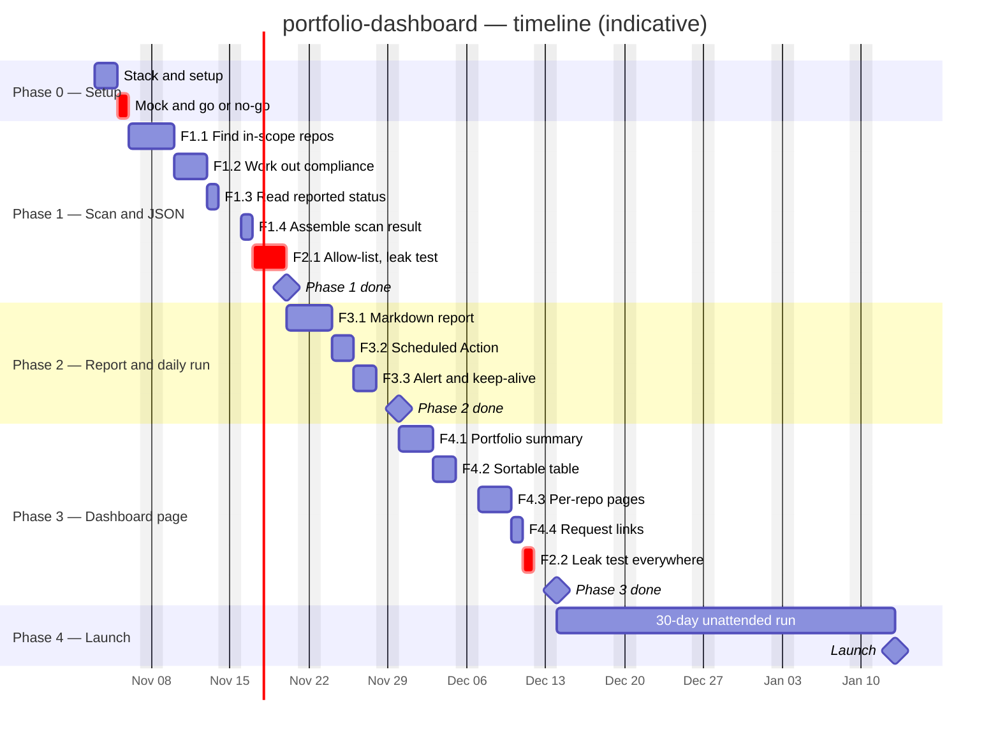

# Project plan

A public, read-only GitHub Pages dashboard of my active repos, rebuilt daily
from real data. See `02-architecture.md` for how the phases below map to system
components.

This doc is about *when*; `01-requirements.md` is about *what*. Each phase
lists the features/stories it delivers by ID, plus any setup tasks that
aren't stories.

Each phase has a goal, a task list, and exit criteria. A phase is done when
its exit criteria are met and the "before marking a phase done" section of
`07-testing-checklist.md` passes — not when the tasks are ticked.

## Phase 0 — Setup and go/no-go
**Estimate:** 2-3 days
**Goal:** Prove the toolchain and the riskiest assumptions, with no real logic
yet.

- [ ] Choose and record the stack with `/stack` (`AGENTS.md` → Choosing the stack)
- [ ] Decide whether to reuse `check-compliance.ps1` or reimplement its checks, including how strict the `schema` check is (`05-decisions-log.md`)
- [ ] Run `check-compliance.ps1` on all 13 repos
- [ ] Hand-build one mock page from the results and decide go or no-go. **The mock contains private data, so it stays outside this repo.**
- [ ] Create a read-only token and read one private repo from an Action, logging nothing
- [ ] Set up the environment and dependencies
- [ ] Create the test folders (`07-testing-checklist.md` → Kinds of tests)
      and run one passing test from the test runner
- [ ] Fill in `AGENTS.md` → Commands (run, test, coverage, lint, format)
- [x] Make the first commit on `main` (`13-git-workflow.md`)
- [x] Create the GitHub repo and push `main`
- [ ] (Optional) protect `main` (`13-git-workflow.md`)
- [ ] Turn on Dependabot and secret scanning (`14-security.md` → GitHub setup)
- [ ] Copy `.env.example` to `.env` for the local token
- [ ] First pass of the threat model (`14-security.md`)
- [ ] Trim `15-accessibility.md` to what applies to this page
- [ ] Fill in the non-functional requirements (`01-requirements.md`)

**Exit criteria:** The go/no-go is decided and logged, and an Action has read a
private repo with nothing private in its logs. If the mock is a no-go, the
Phase 4 rollout tasks move ahead of Phase 1.

## Phase 1 — Scan and JSON
**Estimate:** 10 days at most (10 stories)
**Goal:** Produce a correct, filtered scan output on real repos, run locally,
with nothing published.
**Delivers:** F1.1, F1.2, F1.3, F1.4, F2.1

- [ ] S1.1.1 — Select in-scope repos
- [ ] S1.1.2 — Read repo facts
- [ ] S1.2.1 — Evaluate check kinds
- [ ] S1.2.2 — Work out the compliance level
- [ ] S1.2.3 — Work out scan warnings
- [ ] S1.3.1 — Read `portfolio.json`
- [ ] S1.4.1 — Assemble the scan result
- [ ] S2.1.1 — Allow-list filter
- [ ] S2.1.2 — Write only filtered output, with a leak test
- [ ] S2.1.3 — Keep logs safe

**Exit criteria:** A local run on the real repos lists all 13, levels match
`check-compliance.ps1`, and the leak test passes for output files and logs.

## Phase 2 — Report and daily run
**Estimate:** To be set when its stories are written
**Goal:** The scan runs itself every day and publishes a Markdown report.
**Delivers:** F3.1, F3.2, F3.3

- [ ] Decide how the output gets published (`05-decisions-log.md`), since committed output stays in public history
- [ ] Write the stories for F3.1, F3.2, F3.3

**Exit criteria:** The daily run needs no manual steps, a failed run leaves the
last good version up, and a forced failure sends an alert.

## Phase 3 — Dashboard page
**Estimate:** To be set when its stories are written
**Goal:** A reader gets the whole picture from one link and can drill down.
**Delivers:** F4.1, F4.2, F4.3, F4.4, F2.2

- [ ] Decide the "needs attention first" ranking (`05-decisions-log.md`)
- [ ] Write the stories for F4.1, F4.2, F4.3, F4.4, F2.2

**Exit criteria:** The page is live on GitHub Pages, meets the checks in
`15-accessibility.md`, and the leak test covers the report and the built page.

## Phase 4 — Launch and tuning
**Estimate:** At least 30 days, because of the unattended run
**Goal:** Meet the success criteria in `00-vision.md` on real data.

- [ ] Rollout: get at least 4 repos to Level 2 or higher with real status data (done by hand in those repos, not by the dashboard)
- [ ] Run the daily rebuild for 30 days straight with no manual steps
- [ ] First-reader test: someone new says, within 3 minutes and without help, how healthy the portfolio is and which project needs attention first
- [ ] Check the page at least weekly for a month

**Exit criteria:** Every item under "Success looks like" in `00-vision.md` is
met, and the link is good enough to send to a hiring manager.

## Status

Fill in planned dates when the plan is made; fill in actual dates as phases
start and finish. Never overwrite the planned dates — the gap between
planned and actual is what makes estimates better next time.

There is no fixed deadline (`00-vision.md` → Constraints), so planned dates
stay blank unless one gets set.

| Phase | Status | Planned start | Planned end | Actual start | Actual end |
|---|---|---|---|---|---|
| 0 — Setup and go/no-go | Not started | | | | |
| 1 — Scan and JSON | Not started | | | | |
| 2 — Report and daily run | Not started | | | | |
| 3 — Dashboard page | Not started | | | | |
| 4 — Launch and tuning | Not started | | Ongoing | | |

**Statuses:** `Not started` · `In progress` · `Done` · `Blocked`

## Timeline

Gantt chart of the plan, by phase and feature. Written in Mermaid, so it
renders on GitHub and in VS Code's Markdown preview (with the "Markdown
Preview Mermaid Support" extension).

How to maintain it:
- One `section` per phase, one bar per feature (use its ID from
  `01-requirements.md`) or setup task.
- Mark bars `done` or `active` as work progresses; add `crit` to anything
  on the critical path or running late.
- Use `after <id>` for dependencies so later bars shift automatically when
  an earlier one moves.

Mermaid needs dates, so the start date and durations below are rough and only
show the order of work. They aren't commitments. Phases 2 and 3 get real
durations when their stories are written.

