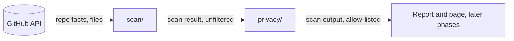

# Architecture

How the system is put together. Rules for this file and its diagrams: the
standard's `decisions.md` → Architecture docs and diagrams. Diagrams must
match the code: update them in the same change.

## Overview

A batch job. Once a day a GitHub Action scans the in-scope repos over the
GitHub API, works out each repo's facts, compliance and reported status,
passes the result through the allow-list filter, and publishes only the
filtered output: a Markdown report (Phase 2) and a static GitHub Pages site
(Phase 3). Nothing persists between runs: each scan starts fresh.

### Components



Only `scan/repos.py` exists so far (S1.1.1: the repo listing and scope
rule, taking a fetch function); the rest is the planned flow from the
requirements and the glossary. Check it against the code as stories land.

## Layout

```
portfolio-dashboard/
  scan/            # reads repos; works out facts, compliance and status; assembles the scan result
  privacy/         # allow-list filter; the only component that writes scan output
  tests/           # mirrors the module structure above
  docs/            # these planning docs
  main.py          # wires the components together
  requirements.txt      # runtime dependencies, pinned
  requirements-dev.txt  # dev tools, pinned
```

One component per top-level folder. Later phases add their own folders when
their stories start. `scan/` never writes to disk, and logic in `scan/` takes
fetched data as input, so only one module there touches the network.

## Naming

- Modules/files: `snake_case`
- Functions/variables: `snake_case`
- Classes/types: `PascalCase`
- Field names at component boundaries stay identical across the whole
  codebase — pick one spelling and never mix variants.
- Test files: `test_<module>.py`, mirroring the source file name

## Design decisions

How significant choices are made: the standard's `decisions.md`. Full
entries are in `decisions.md`.

### Open design questions

- How does the output get published? → decide at the start of Phase 2
- How is "needs attention first" ranked? → decide at the start of Phase 3

### Key decisions

| Area | Chosen | Main alternative rejected | Trade-off accepted | Decision |
|---|---|---|---|---|
| Hosting | Static dashboard on GitHub Pages, on real data | Markdown report only; demo data | A token to look after, and a filter for private data | `decisions.md` → "Product direction: static dashboard on real data" |
| Language and stack | Python 3.13 with `urllib`, `jsonschema`, and `Jinja2` from Phase 3 | TypeScript on Node; PowerShell 7 | The 4 check kinds exist in Python as well as PowerShell | `decisions.md` → "Language and stack" |
| Compliance checks | Reimplemented in Python with full schema validation, reading the registry at run time | Running `check-compliance.ps1`; top-level validation only | Can disagree with the script on C4 until it is fixed | `decisions.md` → "Reuse or reimplement the compliance checks" |
| Repo scope | Spec exclusions plus pushed since 2026-01-01 | Rolling 12 months; spec rule only | Repos never age out unless archived or tagged | `decisions.md` → "Repo scope: spec exclusions plus a fixed cut-off" |
| Private repos | Real name plus signals, from an allow-list | Masked names; adding a summary | Private rows don't say which checks failed | `decisions.md` → "Private repos: real name plus signals" |
| Scan failure | Publish partial and flag it | All or nothing | A "could not scan" row may be visible for a day | `decisions.md` → "Scan failure: publish partial and flag it" |

## Tech stack

Every dependency appears here with a reason. Adding one needs a logged
decision first (the standard's `security.md` → Dependencies).

### Core

| Layer | Choice | Rationale |
|---|---|---|
| Language | Python 3.13 | Default for a batch job with no browser framework. See `decisions.md` → "Language and stack" |
| GitHub API | Standard library `urllib` | Enough for the calls and paging the scan needs, with no dependency. Tests pass in a fake fetch function. Switch only if a story proves it isn't enough |
| Schema validation | `jsonschema` | Full validation of `portfolio.json` against the standard's schema (check C4). See `decisions.md` → "Reuse or reimplement the compliance checks" |
| Page | Generated static HTML with a little vanilla JS | Sorting needs no framework. The HTML templating library is added in Phase 3 (see Deferred) |
| Persistence | None between runs | No database (`requirements.md` → Non-goals). Each scan starts fresh |

### Dev environment

| Tool | Purpose |
|---|---|
| VS Code | Primary editor |
| `ruff format` | Formatting |
| `ruff check` | Linting |
| `pytest` | Tests |
| `pytest-cov` | Coverage report (a hint, no target %) |
| `pip-audit` | Known vulnerabilities in dependencies (`security.md`) |
| `venv` | Dependency isolation, in `.venv/` |

### Starting dependencies

Versions confirmed on PyPI on 2026-11-02. Packages these pull in, including the
compiled `rpds-py` under `jsonschema`, get checked when they are first installed.

`requirements.txt`:

```
jsonschema==4.26.0
```

`requirements-dev.txt`:

```
pytest==9.2.0
pytest-cov==7.1.0
ruff==0.17.3
pip-audit==2.10.1
```

### Deferred / not needed yet

- `Jinja2` — add in Phase 3 for the page, because it can auto-escape untrusted text. 3.1.6 is the latest on PyPI, released 2025-03, so run `pip-audit` on it again then.
- `mypy` — `ruff` doesn't check types, so signatures are typed but not enforced. Revisit if type mistakes reach review.
- `requests` and HTTP mocking libraries — not needed while `urllib` and a fake fetch function are enough.

## Words and names

Use these terms in code names, docs and replies. When a new concept comes
in, add it here in the same change. **Use instead of** lists the synonyms
ruled out: if one shows up in code or docs, rename it.

| Term | Meaning | Use instead of |
|---|---|---|
| allow-list | The fields a private repo may publish: name, visibility, lifecycle, health, compliance level, last activity date, risk count, blocker count, scan status. Anything else is dropped. | "blacklist", "redaction list" |
| canary value | A unique made-up string planted in a fixture private repo. If it shows up in output or logs, something leaked. | "marker", "secret" |
| check registry | `spec/compliance-checks.json` in `pmo-project-standardization`: the machine-readable compliance checks. Read at scan time, never copied here. | "rules file" |
| compliance level | A repo's standing against the standard, worked out by the scan: 0 Not on standard, 1 Reporting, 2 Adopted, 3 Current. | "score", "grade" |
| in-scope repo | A repo the portfolio counts: not archived, not a fork, not tagged `portfolio-exclude`, and pushed since the scan cut-off. | "active repo", "tracked repo" |
| leak test | The automated test that plants canary values in a private repo and fails if any reach output files or logs. | "privacy check" |
| request link | A link on the page that opens a pre-filled GitHub issue for a public repo's owner. It changes nothing by itself. | "action button", "update button" |
| scan | One run that reads all in-scope repos and works out their facts, compliance and status. | "crawl", "sync" |
| scan cut-off | The fixed date 2026-01-01. Repos last pushed before it are out of scope. | "activity window" |
| scan output | The scan result after the allow-list filter: the only form written to disk or published. | "report data" |
| scan result | The in-memory, unfiltered structure a scan assembles, marked complete, partial or failed. Never written to disk. | "raw output" |
| scan warning | A warning that needs GitHub data or dates: S1 stale report, S2 health never reported, S3 required change due soon (`spec/compliance.md`). Not the same as story IDs. | — |
